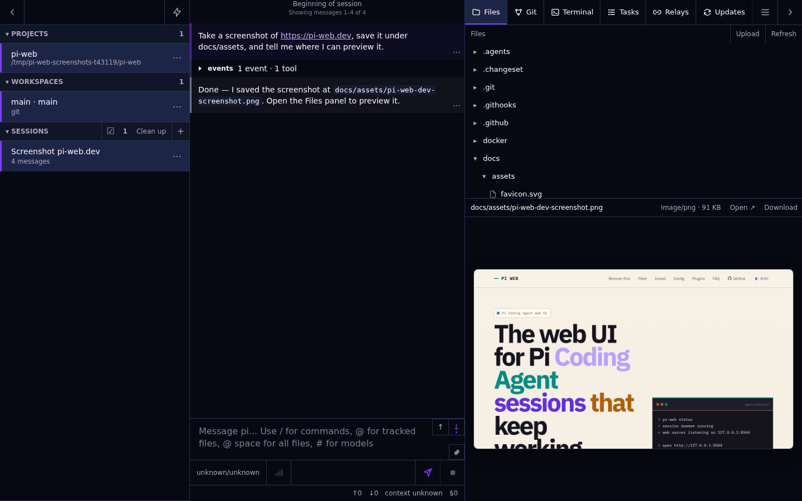
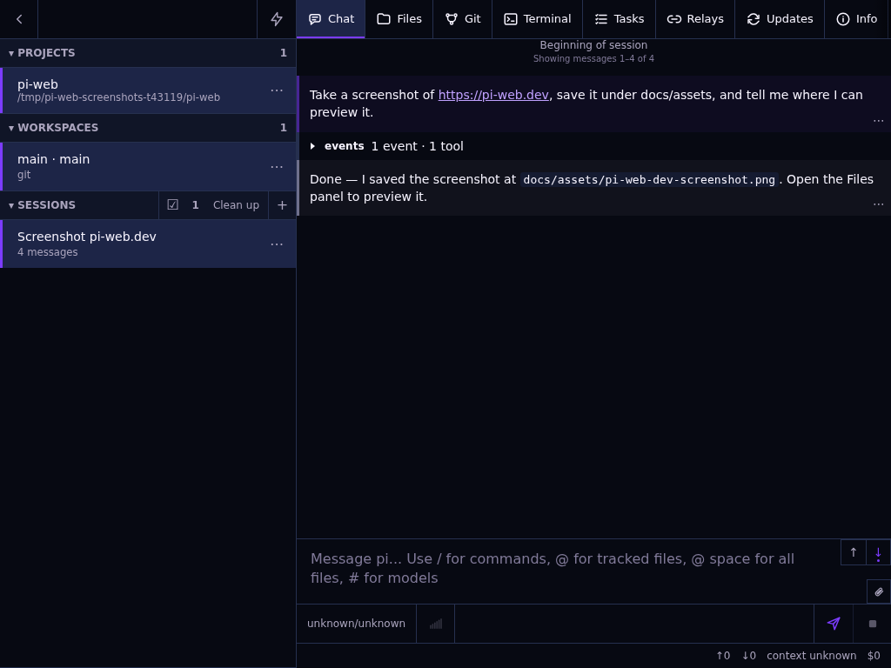
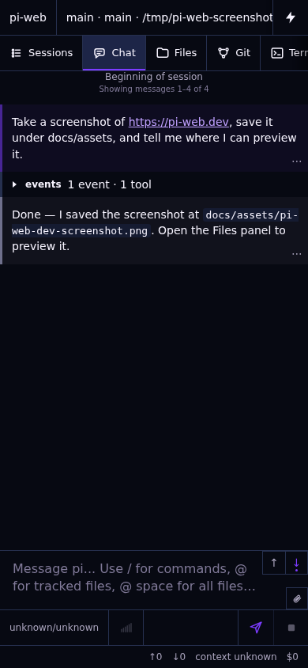

# PI WEB

[](https://github.com/jmfederico/pi-web/actions/workflows/ci.yml)
[](https://www.npmjs.com/package/@jmfederico/pi-web)
[](package.json)
[](LICENSE)

**PI WEB is a web UI for [Pi Coding Agent](https://github.com/earendil-works/pi/tree/main/packages/coding-agent) that keeps agent sessions running in real workspaces on your machine or server.**

Run agents where your code, tools, credentials, and build caches live. Supervise multiple sessions from any browser, even after disconnecting.



<p align="center">
  
  
</p>

[Explore devices and themes](https://pi-web.dev/)

## Quick start

The recommended setup uses Node.js 22.19.0+, npm, Pi Coding Agent installed and configured for your user, git, and the development tools your agents need. [Best-effort Bun support](https://pi-web.dev/install#bun) is also available.

```bash
npm install -g @jmfederico/pi-web --allow-scripts=node-pty
pi-web install
pi-web doctor
```

On npm 12, the scoped flag lets `node-pty` prepare its required native module.

Open <http://127.0.0.1:8504>. Add a project, choose a workspace or Git worktree, and start a session.

```bash
pi-web status
pi-web logs
pi-web restart
pi-web update
pi-web uninstall
```

For installation variants, Docker, and remote access, see the [installation guide](https://pi-web.dev/install).

## Core model

- **Machine:** a local or remote PI WEB runtime.
- **Project:** a folder on that machine.
- **Workspace:** a working folder, such as a Git worktree.
- **Session:** a Pi Coding Agent conversation running in a workspace.

Use files, terminals, plugins, and agent workflows in one UI. Register remote machines to supervise work across a fleet.

## Security

PI WEB assumes trusted users, repositories, paths, and plugins. It is not a sandbox or a multi-tenant platform.

For remote access, use a trusted private network, VPN, SSH tunnel, or authenticated reverse proxy. Do not expose PI WEB directly to the public internet.

## Documentation

- [Website](https://pi-web.dev/)
- [Install](https://pi-web.dev/install)
- [Remote-first development](https://pi-web.dev/remote-first)
- [Machines / fleet](https://pi-web.dev/machines)
- [Configuration](https://pi-web.dev/config)
- [Plugins](https://pi-web.dev/plugins)
- [FAQ](https://pi-web.dev/faq)

## Development

```bash
npm install
npm run dev
```

Open the Vite URL, usually <http://localhost:8505>. See [development checks](docs/development-checks.md) for verification guidance.

## License

MIT © 2026 Federico Jaramillo Martinez. See [LICENSE](LICENSE).
